# SPORTSHOP – Hệ thống bán hàng và quản lý khách hàng

Hệ thống cho một cửa hàng đồ thể thao, gồm:

- **Web quản trị** (`Frontend/SportShop.Admin`) cho Quản lý và Nhân viên: khách hàng, nhân viên, sản phẩm, nhập hàng, đơn hàng,
  hóa đơn, khuyến mãi, phản hồi, khảo sát, báo cáo thống kê.
- **Web khách hàng** (`Frontend/SportShop.CustomerWeb`) để khách xem sản phẩm, mua hàng, theo dõi đơn, gửi phản hồi và làm khảo sát.
- **App di động** (`MobileApp`, .NET MAUI) cho khách hàng — chức năng tương tự web khách hàng, sẽ làm sau.
- **Cơ sở dữ liệu MySQL** dùng chung cho cả hai web (`Backend/Database/sports_shop.sql`).

Công nghệ: ASP.NET Core MVC (.NET 10), Dapper + MySqlConnector, MySQL 8.

## Cấu trúc thư mục

```
WEBAPP_SPORT/
├── Backend/
│   ├── Database/
│   │   ├── sports_shop.sql            # Script MySQL: Schema 35 bảng gốc + dữ liệu demo
│   │   └── Migrations/                # Các bản vá nâng cấp CSDL (Auth mobile, Giỏ DB, Phương thức TT, Thiết bị khách)
│   ├── SportShop.Api/                 # REST Web API v1 cho Mobile App (Port :5080)
│   ├── SportShop.Application/         # Use cases và interfaces backend
│   ├── SportShop.Contracts/           # Data Transfer Objects (DTO) cho API
│   ├── SportShop.Infrastructure/      # Xử lý truy vấn MySQL Dapper cho API
│   ├── SportShop.Shared/              # Services/Models dùng chung giữa Web và API
│   ├── SportShop.Api.Tests/           # Bộ kiểm thử tự động (Unit & Integration Tests)
│   └── Images/                        # Kho ảnh sản phẩm gốc (phục vụ qua /images)
├── Frontend/
│   ├── SportShop.Admin/               # Web quản trị
│   ├── SportShop.CustomerWeb/         # Web khách hàng
│   └── Uploads/                       # Ảnh tải lên từ web quản trị, hai web phục vụ tại /uploads (git bỏ qua)
├── MobileApp/                         # App điện thoại cho khách hàng (.NET MAUI), chưa làm
├── Admin Dashboard for SPORTSHOP/     # Mã nguồn thiết kế Figma (React), chỉ để tham khảo giao diện
└── SportShop.slnx                     # Solution mở bằng Visual Studio
```

## Cách chạy

Yêu cầu: Visual Studio có .NET 10 SDK và MySQL 8.

1. **Tạo CSDL:** mở MySQL Workbench, kết nối tới server, chọn File → Open SQL Script → `Backend/Database/sports_shop.sql`, bấm ⚡
   (Ctrl + Shift + Enter, chạy cả script). Kết quả đúng là schema `sports_shop` có **35 bảng**.
2. **Cấu hình kết nối:** tạo file `appsettings.Local.json` đặt cạnh `appsettings.json` của **cả hai** web:

```json
"ConnectionStrings": {
  "Default": "Server=localhost;Port=3306;Database=sports_shop;User=root;Password=MAT_KHAU_CUA_BAN;"
}
```
*(Mẹo: Bạn có thể tạo file `appsettings.Local.json` đặt cạnh `appsettings.json` với nội dung trên để không bao giờ bị lộ mật khẩu khi đẩy code lên GitHub).*

---

## 🚀 Hướng dẫn chạy dự án

### 🟣 Cách 1: Chạy bằng Visual Studio (Bản tím) - *Khuyến nghị*
1. Nhấp đúp mở file **`SportShop.slnx`** bằng Visual Studio 2022 trở lên.
2. Chuột phải vào **Solution 'SportShop'** trong cửa sổ Solution Explorer ➔ Chọn **Configure Startup Projects...**
3. Tích chọn **Multiple startup projects**, cài đặt:
   - `SportShop.Admin` ➔ Chọn **Start**
   - `SportShop.CustomerWeb` ➔ Chọn **Start**
   - *(Tùy chọn)* `SportShop.Api` ➔ Chọn **Start** (nếu muốn chạy cả REST API)
4. Trên thanh công cụ phía trên, đổi cấu hình Debug Target sang **`http`** (để tránh lỗi chứng chỉ SSL).
5. Nhấn **F5** (chạy kèm Debug) hoặc **Ctrl + F5** (chạy trực tiếp).
6. Trình duyệt sẽ tự động mở 2 trang:
   - **Web Quản trị:** [http://localhost:5188](http://localhost:5188)
   - **Web Khách hàng:** [http://localhost:5003](http://localhost:5003)

---

### 🔵 Cách 2: Chạy bằng Visual Studio Code (Bản xanh)

#### Cách A: Chạy trực tiếp qua Terminal
Mở thư mục dự án trong VS Code, mở 2 tab Terminal (`Ctrl + \``) và chạy:

**Terminal 1 (Web Quản trị):**
```bash
dotnet run --project Frontend/SportShop.Admin --launch-profile http
```

**Terminal 2 (Web Khách hàng):**
```bash
dotnet run --project Frontend/SportShop.CustomerWeb --launch-profile http
```

#### Cách B: Chạy ngầm (Tắt Terminal đi web vẫn chạy bình thường)
Mở Terminal trong VS Code chạy 2 lệnh sau:
```powershell
Start-Process dotnet -ArgumentList "run --project Frontend/SportShop.Admin --launch-profile http" -WindowStyle Hidden
Start-Process dotnet -ArgumentList "run --project Frontend/SportShop.CustomerWeb --launch-profile http" -WindowStyle Hidden
```
*Sau khi gõ xong, bạn có thể bấm nút 🗑️ xóa tab Terminal hoặc tắt luôn cửa sổ Terminal, web vẫn chạy ngầm dưới nền Windows.*

🛑 **Khi nào test xong muốn tắt hẳn web ngầm:**
Mở Terminal gõ lệnh:
```powershell
Stop-Process -Name dotnet -Force
```

---

### 📱 Mẹo: Kết nối điện thoại bằng Dev Tunnels trong VS Code
Để vừa mở web trên laptop, vừa mở trên điện thoại (dùng 4G hoặc Wi-Fi bất kỳ) mà không cần cấu hình IP:
1. Nhìn xuống bảng điều khiển dưới chân VS Code ➔ Chọn tab **PORTS** (Cổng).
2. Bấm **Forward a Port** ➔ Nhập `5003` ➔ Bấm Enter.
3. Chuột phải vào dòng port `5003` ➔ Chọn **Port Visibility** ➔ Chọn **Public**.
4. Copy link HTTPS ở cột **Forwarded Address** (dạng `https://xxxx-5003.asse.devtunnels.ms`) gửi sang điện thoại và mở bằng trình duyệt (bấm nút **Continue** ở màn hình xác thực đầu tiên là vào web ngay).

---

## 🔑 Tài khoản demo

Tất cả tài khoản demo đều có mật khẩu: **`123456`**

| Hệ thống | Tài khoản | Vai trò / Phân hạng | Ghi chú |
|---|---|---|---|
| **Web Quản trị** | `admin` | Quản lý (Admin) | Toàn quyền xem doanh thu, nhân viên, cấu hình |
| | `nv_lan`, `nv_tuan` | Nhân viên bán hàng | Bán hàng, duyệt đơn (bị chặn vào QL nhân viên) |
| **Web Khách hàng** | `kh_an` | Hạng Vàng (Gold) | Chi tiêu > 5tr, áp dụng được voucher Vàng |
| | `kh_khanh` | Hạng Bạc (Silver) | Chi tiêu > 2tr, áp dụng được voucher Bạc |
| | `kh_binh`, `kh_mai` | Hạng Thường | Khách hàng chuẩn |
| | `kh_dung` | Bị khóa | Tài khoản demo bị khóa |

---

## 📸 Giao diện các màn hình & Thư viện ảnh chụp

*(Ảnh chụp thực tế nằm trong thư mục `docs/screenshots/`; bấm vào ảnh để xem cỡ lớn).*

### A. Màn hình Web Khách hàng (`SportShop.CustomerWeb`)

| Màn hình | Chức năng nổi bật | Ảnh chụp |
|---|---|---|
| **Trang chủ (`/`)** | Banner khuyến mãi, danh mục thể thao trực quan, 8 sản phẩm nổi bật mới nhất. | <a href="docs/screenshots/customer_home.png">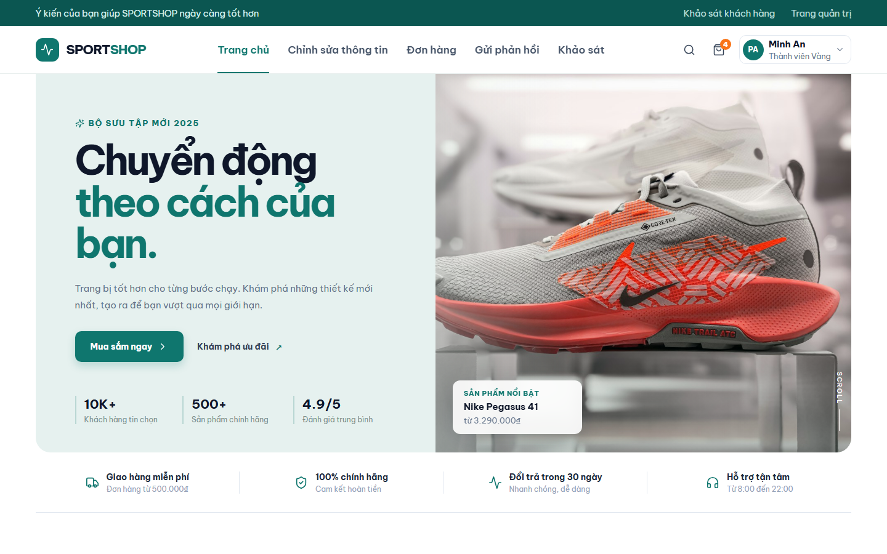</a> |
| **Cửa hàng (`/Shop`)** | Lưới sản phẩm, bộ lọc theo danh mục, sắp xếp theo giá và tên, phân trang. | <a href="docs/screenshots/customer_shop.png">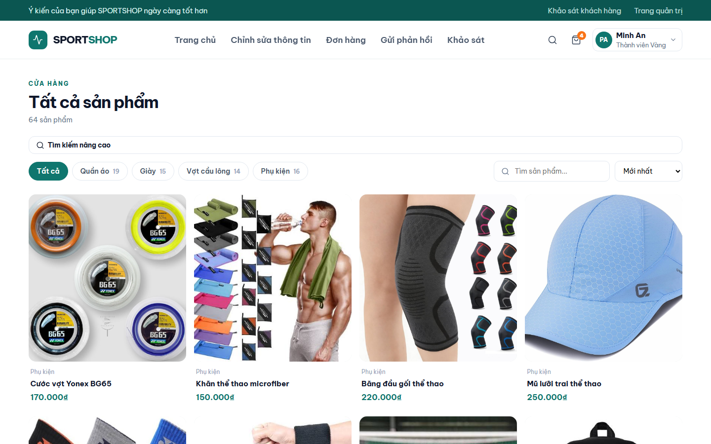</a> |
| **Tìm kiếm nâng cao** | Lọc chi tiết sản phẩm theo khoảng giá (Min - Max), kích cỡ (Size) và màu sắc. | <a href="docs/screenshots/customer_search_adv.png">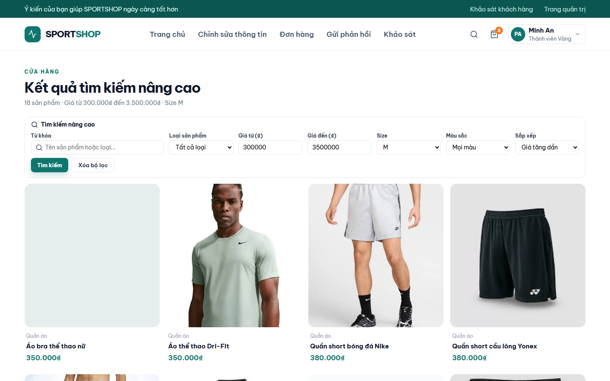</a> |
| **Chi tiết sản phẩm** | Đổi ảnh theo màu sắc được chọn, kiểm tra tồn kho theo từng size, mua ngay / thêm giỏ. | <a href="docs/screenshots/customer_product_detail.png">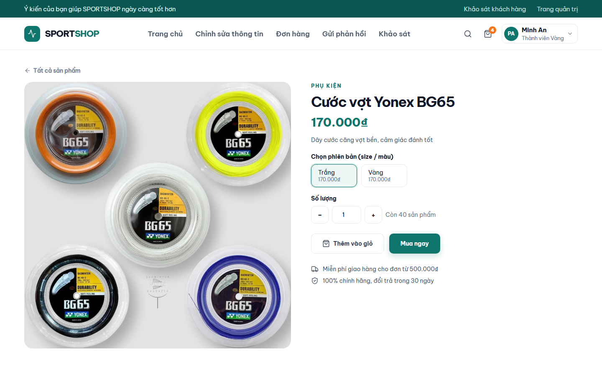</a> |
| **Đơn hàng của tôi** | Luồng 4 bước theo dõi trạng thái đơn hàng, nút tự hủy đơn chờ, xem chi tiết đơn. | <a href="docs/screenshots/customer_orders.png">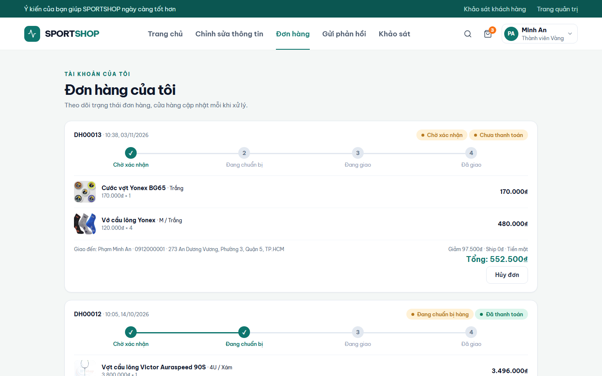</a> |
| **Đánh giá & Phản hồi** | Đánh giá sao (1 - 5⭐) cho sản phẩm đã mua thành công, xem phản hồi của cửa hàng. | <a href="docs/screenshots/customer_feedback.png">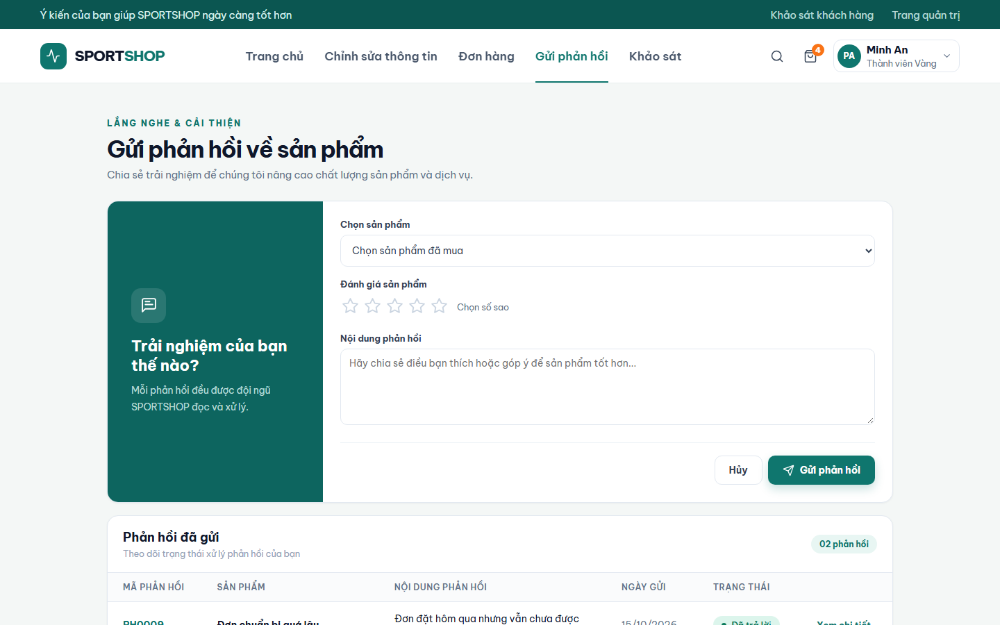</a> |
| **Khảo sát khách hàng** | Giao diện làm khảo sát trải nghiệm dịch vụ (câu hỏi trắc nghiệm & ý kiến tự luận). | <a href="docs/screenshots/customer_surveys.png">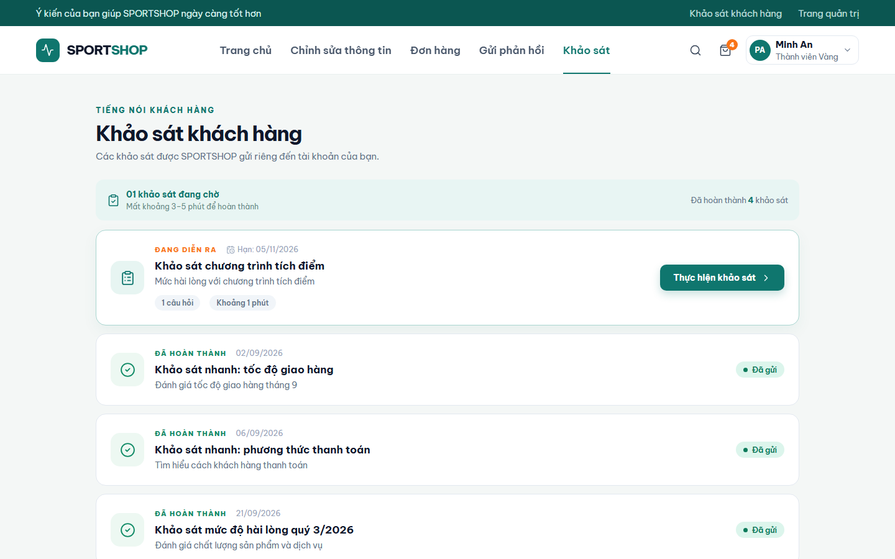</a> |
| **Hồ sơ cá nhân** | Quản lý thông tin, cập nhật sở thích thể thao, đổi mật khẩu bảo mật (khóa 5p nếu sai 5 lần). | <a href="docs/screenshots/customer_profile.png">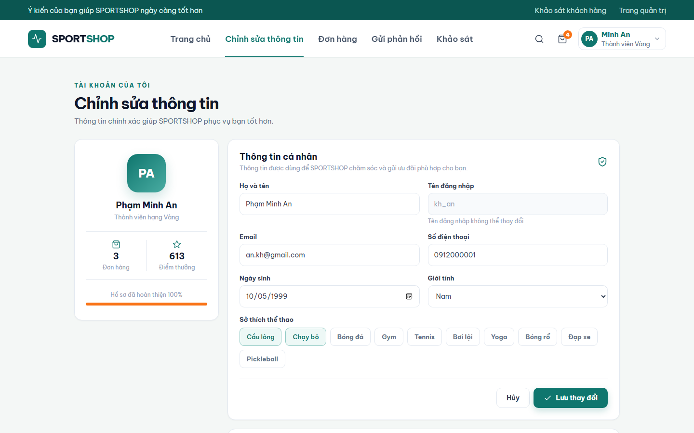</a> |
| **Đăng nhập / Đăng ký** | Giao diện đăng thực hiện đại, hỗ trợ chuyển đổi giữa đăng ký mới và đăng nhập. | <a href="docs/screenshots/customer_auth.png">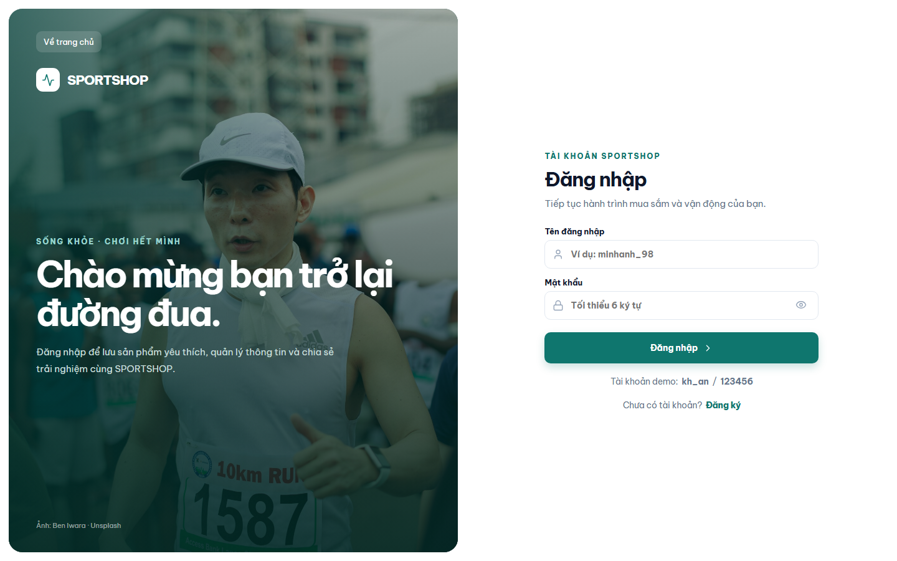</a> |

---

### B. Quy trình Giỏ hàng & Lúc mua hàng (Trọng tâm)

Quy trình mua hàng từ khi chọn sản phẩm tới khi hoàn tất thanh toán:

| Bước quy trình | Mô tả trải nghiệm | Ảnh chụp |
|---|---|---|
| **1. Thêm vào giỏ** | Popup thông báo thêm sản phẩm thành công, cập nhật số lượng tồn kho tức thì. | <a href="docs/screenshots/order_step1_add_cart.png">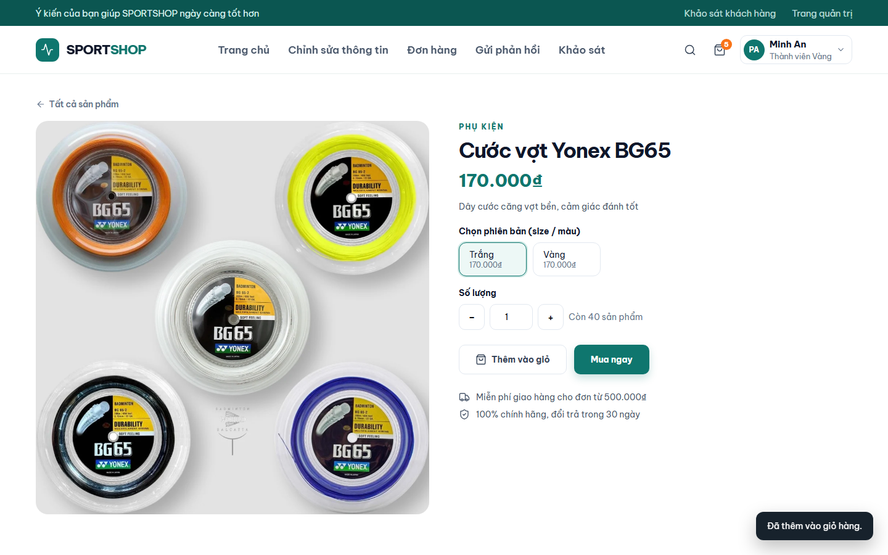</a> |
| **2. Xem Giỏ hàng (`/Cart`)** | Bảng danh sách món hàng, nút tăng giảm số lượng, cảnh báo vượt quá tồn kho, tạm tính tiền. | <a href="docs/screenshots/order_step2_cart_view.png">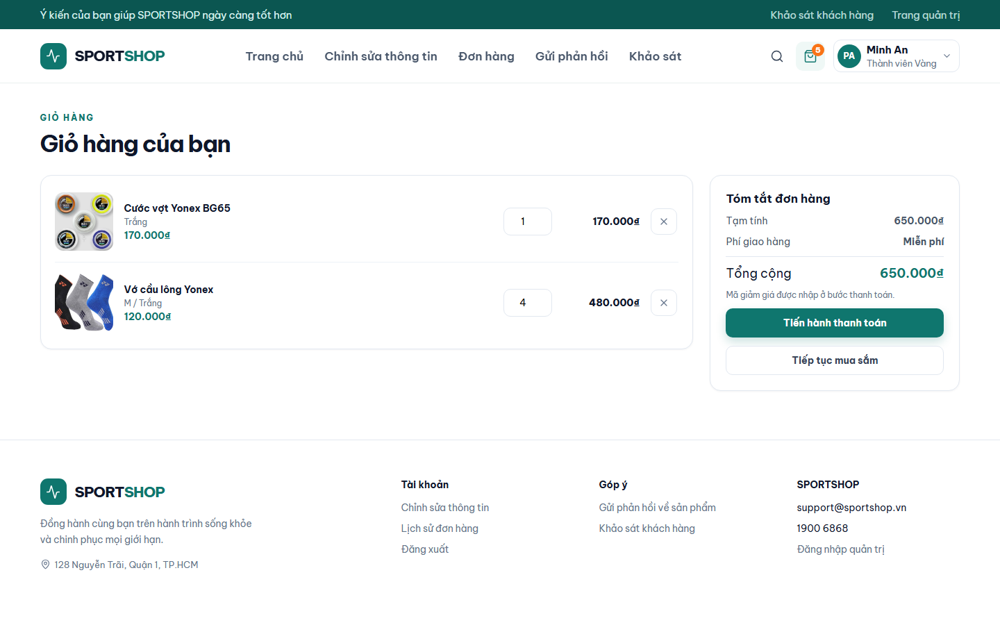</a> |
| **3. Thanh toán: Thông tin nhận** | Tự động điền người nhận từ sổ địa chỉ, sửa tên, số điện thoại và địa chỉ giao hàng. | <a href="docs/screenshots/order_step3_checkout_info.png">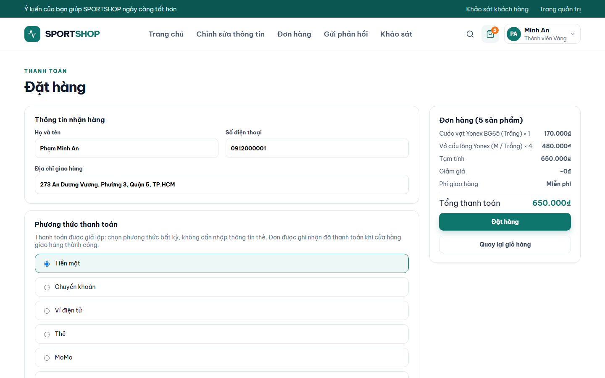</a> |
| **4. Thanh toán: Chọn Phương thức** | Lựa chọn phương thức thanh toán: COD, Chuyển khoản ngân hàng, Ví điện tử, Thẻ ATM/Visa. | <a href="docs/screenshots/order_step4_checkout_payment.png">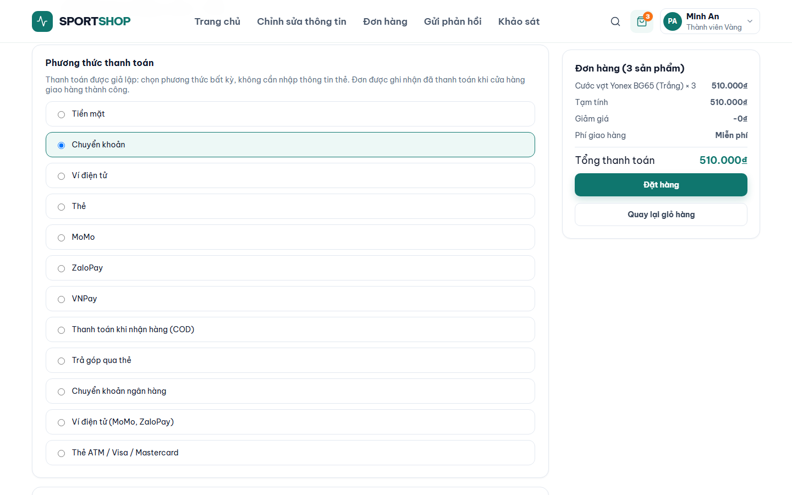</a> |
| **5. Áp dụng Mã giảm giá** | Danh sách voucher khả dụng theo hạng thành viên kèm số tiền giảm giá chi tiết, tính phí ship. | <a href="docs/screenshots/order_step5_apply_voucher.png">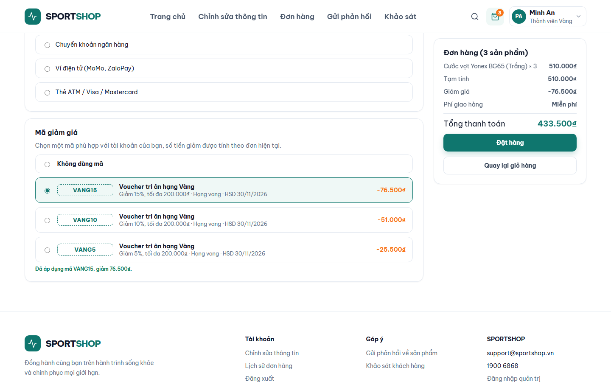</a> |
| **6. Đặt hàng thành công (`/Done`)** | Màn hình xác nhận hoàn tất đơn hàng, hiển thị mã đơn hàng `DHxxxxx` và hướng dẫn theo dõi. | <a href="docs/screenshots/order_step6_order_done.png">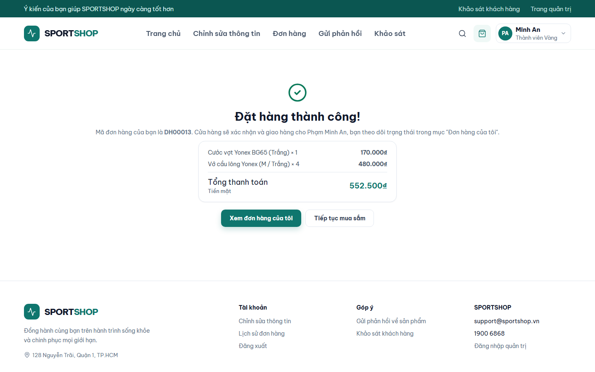</a> |

---

### C. Màn hình Web Quản trị (`SportShop.Admin`)

| Màn hình | Chức năng nổi bật | Ảnh chụp |
|---|---|---|
| Quản trị | `Models/ShopData.cs` (nạp từng danh sách khi cần, mỗi request một bản) | `Models/ShopCommands.cs` qua `Controllers/CrudController.cs` (Form, Save, Delete, Act) |
| Khách hàng | `Services/ShopStore.cs`, `Services/CustomerStore.cs` | Cùng hai lớp trên |

- Biểu mẫu thêm / sửa của web quản trị được dựng tự động từ `Models/CrudDefs.cs`; JavaScript giao diện ở `wwwroot/js/admin.js` và `wwwroot/js/search-kit.js`.
- Đa phiên theo tab: `Models/TabCookies.cs` (Admin) và `Services/TabCookies.cs` (CustomerWeb) cùng với `wwwroot/js/tab-session.js` ở mỗi web.
- Mỗi hàm chính có một dòng ghi chú ngay phía trên: hàm làm gì, lấy / ghi dữ liệu ở đâu (bảng MySQL, file, session) và gọi hàm nào, file nào. Không ghi chú từng dòng lệnh.

## Cơ sở dữ liệu

MySQL 8, 35 bảng, kèm dữ liệu demo. Bảng `KHACH_HANG` có cột `da_xoa` để xóa mềm khách hàng.
CSDL tạo trước khi có cột này thì thêm bằng lệnh (không mất dữ liệu):

```sql
ALTER TABLE KHACH_HANG ADD COLUMN da_xoa TINYINT(1) NOT NULL DEFAULT 0 AFTER tong_chi_tieu;
```

## Gặp lỗi

- **Web quản trị báo "Lỗi kết nối CSDL":** kiểm tra dịch vụ MySQL đang chạy (`services.msc`), đúng cổng và mật khẩu trong `appsettings.json`.
  Máy có nhiều server MySQL (ví dụ cổng 3306 và 3307) thì cổng trong file phải đúng server đã chạy script.
  Web khách hàng không kết nối được thì các chức năng cần dữ liệu hiện thông báo cần kết nối cơ sở dữ liệu.
- **`Table '...' doesn't exist` hoặc `Unknown column 'da_xoa'`:** kiểm tra schema cũ và các migration 001–003; thêm `da_xoa` bằng lệnh `ALTER TABLE` ở trên nếu thiếu. Không chạy lại script tạo DB để nâng cấp dữ liệu đang có.
- **Mã nhân viên ở góc phải (ví dụ NV011) không đúng sau khi tạo lại CSDL:** mã này lưu trong cookie đăng nhập cũ; đăng xuất rồi đăng nhập lại.
  Nếu không, các thao tác ghi người thực hiện (lập đơn, phiếu nhập, trả lời phản hồi) sẽ báo lỗi.
- **Không đăng nhập được web quản trị, báo "Tài khoản khách hàng không được đăng nhập trang quản trị":** tài khoản chưa gắn với hồ sơ nhân viên trong bảng `NHAN_VIEN`.
- **Build báo không chép được file `.exe` / `.dll`:** web đang chạy giữ file; dừng web rồi build lại.

## Chưa làm

- App điện thoại cho khách hàng (`MobileApp`, .NET MAUI) chưa có project; REST API đã có tài khoản/hồ sơ, catalog, giỏ/checkout/đơn, phản hồi/khảo sát và trang thông tin.
- Tự áp dụng khuyến mãi theo sản phẩm và theo mốc đơn hàng ở bước thanh toán (hiện chỉ áp dụng mã voucher).
- Gửi chiến dịch thông báo thật qua email / SMS (hiện chỉ ghi nhận chiến dịch đã gửi).
- Tách lượt dùng voucher theo từng mã trong cùng một chương trình (cần thêm cột lưu mã voucher vào CSDL).

## Phân tích và thiết kế API cho MobileApp

REST API được mở rộng ngày 01/11/2026, dùng chung service/model gốc qua `SportShop.Shared`. Mật khẩu mới mã hóa AES-GCM (Quản lý xem lại được, khóa nằm trong code);
đăng nhập hợp lệ nâng cấp dữ liệu plaintext demo cũ. Mobile dùng opaque bearer access/refresh token, refresh rotation và thu hồi phiên;
đặt đơn có `Idempotency-Key`. Đơn đã thanh toán cần cửa hàng xử lý hoàn tiền, khách không tự hủy để tránh lệch hóa đơn/điểm.
Không đưa token, mật khẩu hoặc DB credential vào app/Git/log. App MAUI chưa được triển khai.

- [Kiểm kê 64 chức năng Web User và API](API_INVENTORY.md).
- [Contract, request/response và lỗi Mobile API](MOBILE_API_DOCUMENTATION.md).
- [Hướng dẫn chạy backend, migration và tích hợp mobile](MOBILE_INTEGRATION_GUIDE.md).
- [Báo cáo kiểm thử và giới hạn xác minh](MOBILE_API_TEST_REPORT.md).
- [Đối chiếu từng màn hình Web → Mobile](Backend/docs/mobile-feature-parity.md).
- [Danh mục file mới/sửa và mã phase-one có sẵn](Backend/docs/mobile-api-change-manifest.md).

Verifier cuối trên instance MySQL sạch: **142/142 PASS, 0 FAIL, 0 SKIP**, build solution **0 lỗi/0 cảnh báo**.
[TRX và hash đối chiếu](Backend/docs/test-evidence/verification-results.json); app/UI native chưa triển khai và chưa kiểm thử.

---

## ❓ Xử lý lỗi thường gặp

1. **Lỗi `Lỗi kết nối CSDL`:** Kiểm tra dịch vụ MySQL đang chạy trong `services.msc`, kiểm tra đúng cổng (3306) và mật khẩu trong `appsettings.json`.
2. **Lỗi `Table doesn't exist`:** Chạy file `Backend/Database/sports_shop.sql` và cả 3 file trong thư mục `Backend/Database/Migrations/`.
3. **Lỗi file `.dll` / `.exe` bị khóa khi build:** Do tiến trình web cũ đang chạy ngầm. Mở PowerShell gõ: `Stop-Process -Name dotnet -Force` rồi build lại.
4. **Bị chặn không vào được trang Quản trị:** Kiểm tra xem tài khoản đăng nhập có được liên kết với hồ sơ trong bảng `NHAN_VIEN` chưa.
