# 🏆 SPORTSHOP – Hệ Thống Bán Hàng & Quản Lý Khách Hàng (CRM)

Hệ thống bán hàng thể thao đa nền tảng và quản trị quan hệ khách hàng (CRM) toàn diện. Được xây dựng theo kiến trúc **ASP.NET Core (.NET 10)**, sử dụng chung cơ sở dữ liệu **MySQL 8** qua **Dapper** với hiệu năng cao, tích hợp REST Web API cho ứng dụng di động, hệ thống đa phiên đăng nhập theo tab độc lập và các công cụ xuất nhập Excel, phân tích doanh thu chuyên sâu.

---

## 📑 Mục lục
1. [Cấu trúc thư mục dự án](#-cấu-trúc-thư-mục-dự-án)
2. [Công nghệ sử dụng](#-công-nghệ-sử-dụng)
3. [Hướng dẫn cài đặt & Cơ sở dữ liệu](#-hướng-dẫn-cài-đặt--cơ-sở-dữ-liệu)
4. [Hướng dẫn chạy dự án](#-hướng-dẫn-chạy-dự-án)
   - [Cách 1: Chạy bằng Visual Studio (Bản tím)](#-cách-1-chạy-bằng-visual-studio-bản-tím-khuyến-nghị)
   - [Cách 2: Chạy bằng Visual Studio Code (Bản xanh)](#-cách-2-chạy-bằng-visual-studio-code-bản-xanh)
   - [Mẹo: Mở mạng cho điện thoại bằng Dev Tunnels](#-mẹo-kết-nối-điện-thoại-bằng-dev-tunnels-trong-vs-code)
5. [Tài khoản demo](#-tài-khoản-demo)
6. [Giao diện các màn hình & Thư viện ảnh chụp](#-giao-diện-các-màn-hình--thư-viện-ảnh-chụp)
   - [A. Màn hình Web Khách hàng (Customer Web)](#a-màn-hình-web-khách-hàng-sportshopcustomerweb)
   - [B. Quy trình Giỏ hàng & Lúc mua hàng (Trọng tâm)](#b-quy-trình-giỏ-hàng--lúc-mua-hàng-trọng-tâm)
   - [C. Màn hình Web Quản trị (Admin Dashboard)](#c-màn-hình-web-quản-trị-sportshopadmin)
7. [Quy tắc nghiệp vụ cốt lõi](#-quy-tắc-nghiệp-vụ-cốt-lõi)
8. [Tổ chức mã nguồn & Kiến trúc](#-tổ-chức-mã-nguồn--kiến-trúc)
9. [Xử lý lỗi thường gặp](#-xử-lý-lỗi-thường-gặp)

---

## 📁 Cấu trúc thư mục dự án

```
WEBAPP_SPORT/
├── Backend/
│   ├── Database/
│   │   ├── sports_shop.sql            # Script MySQL: Schema 35 bảng gốc + dữ liệu demo
│   │   └── Migrations/                # Các bản vá nâng cấp CSDL (Auth mobile, Giỏ DB, Phương thức TT)
│   ├── SportShop.Api/                 # REST Web API v1 cho Mobile App (Port :5080)
│   ├── SportShop.Application/         # Use cases và interfaces backend
│   ├── SportShop.Contracts/           # Data Transfer Objects (DTO) cho API
│   ├── SportShop.Infrastructure/      # Xử lý truy vấn MySQL Dapper cho API
│   ├── SportShop.Shared/              # Services/Models dùng chung giữa Web và API
│   ├── SportShop.Api.Tests/           # Bộ kiểm thử tự động (Unit & Integration Tests)
│   └── Images/                        # Kho ảnh sản phẩm gốc (phục vụ qua /images)
├── Frontend/
│   ├── SportShop.Admin/               # Web quản trị cho Quản lý & Nhân viên (Port :5188)
│   ├── SportShop.CustomerWeb/         # Web bán hàng & chăm sóc khách hàng (Port :5003)
│   └── Uploads/                       # Ảnh sản phẩm tải lên từ admin (Git bỏ qua)
├── MobileApp/                         # App di động cho khách hàng (.NET MAUI - Đang phát triển)
├── Admin Dashboard for SPORTSHOP/     # Bản thiết kế tham khảo giao diện (React / Figma)
├── docs/screenshots/                  # Nơi lưu trữ ảnh chụp màn hình giao diện hệ thống
└── SportShop.slnx                     # Solution quản lý toàn bộ hệ thống
```

---

## 💻 Công nghệ sử dụng

- **Nền tảng:** .NET 10 (C# 13), ASP.NET Core MVC & Web API.
- **Data Access:** Dapper + MySqlConnector (truy vấn trực tiếp, tối ưu hóa tốc độ).
- **Cơ sở dữ liệu:** MySQL 8 (35 bảng chuẩn hóa + các bảng migration mới cho mobile session và giỏ hàng DB).
- **Bộ nhớ đệm:** In-Memory Caching (`CatalogCache` cho web khách, `DataCache` cho web quản trị).
- **Xử lý Excel:** ClosedXML (Nhập/Xuất danh sách sản phẩm biến thể, xuất báo cáo thống kê đa sheet).
- **Frontend Web:** Razor View (.cshtml), Vanilla JavaScript ES6, CSS Grid/Flexbox responsive.
- **Đa phiên:** `TabCookieMiddleware` (độc lập phiên làm việc giữa các tab trình duyệt).

---

## 🛠️ Hướng dẫn cài đặt & Cơ sở dữ liệu

### 1. Chuẩn bị môi trường
- Cài đặt **.NET 10 SDK** (hoặc mới hơn).
- Cài đặt **MySQL Server 8.0** kèm **MySQL Workbench** (hoặc phpMyAdmin / Navicat).

### 2. Thiết lập cơ sở dữ liệu MySQL
1. Mở **MySQL Workbench**, kết nối tới MySQL Server của máy.
2. Chọn **File ➔ Open SQL Script** ➔ chọn `Backend/Database/sports_shop.sql`, bấm **Execute ⚡** (Ctrl + Shift + Enter) để tạo database `sports_shop` (35 bảng).
3. **Chạy các file migration (Rất quan trọng):** Mở và chạy lần lượt 3 file trong thư mục `Backend/Database/Migrations/`:
   - `001_mobile_auth.sql` (Tạo bảng lưu phiên đăng nhập Mobile).
   - `002_commerce.sql` (Tạo bảng giỏ hàng DB và chống trùng đơn hàng).
   - `003_payment_methods.sql` (Khởi tạo 4 phương thức thanh toán mô phỏng).

> **Lưu ý khi muốn tạo lại CSDL từ đầu:** Nếu CSDL đã tồn tại, hãy thêm 2 dòng này lên đầu file `sports_shop.sql` trước khi chạy:
> ```sql
> SET SQL_SAFE_UPDATES = 0;
> DROP DATABASE IF EXISTS sports_shop;
> ```

### 3. Cấu hình chuỗi kết nối (Connection String)
Mở file `appsettings.json` ở cả 2 project (`SportShop.Admin` và `SportShop.CustomerWeb`) và điền mật khẩu MySQL của máy bạn:

```json
"ConnectionStrings": {
  "Default": "Server=localhost;Port=3306;Database=sports_shop;User=root;Password=MAT_KHAU_CUA_BAN;"
}
```
*(Mẹo: Bạn có thể tạo file `appsettings.Local.json` đặt cạnh `appsettings.json` với nội dung trên để không bao giờ bị lộ mật khẩu khi đẩy code lên GitHub).*

---

## 🚀 Hướng dẫn chạy dự án

### 🟣 Cách 1: Chạy bằng Visual Studio (Bản tím) - *Khuyến nghị*
1. Nhấp đúp mở file **`SportShop.slnx`** bằng Visual Studio 2022 trở lên.
2. Chuột phải vào **Solution 'SportShop'** trong cửa sổ Solution Explorer ➔ Chọn **Configure Startup Projects...**
3. Tích chọn **Multiple startup projects**, cài đặt:
   - `SportShop.Admin` ➔ Chọn **Start**
   - `SportShop.CustomerWeb` ➔ Chọn **Start**
   - *(Tùy chọn)* `SportShop.Api` ➔ Chọn **Start** (nếu muốn chạy cả REST API)
4. Trên thanh công cụ phía trên, đổi cấu hình Debug Target sang **`http`** (để tránh lỗi chứng chỉ SSL).
5. Nhấn **F5** (chạy kèm Debug) hoặc **Ctrl + F5** (chạy trực tiếp).
6. Trình duyệt sẽ tự động mở 2 trang:
   - **Web Quản trị:** [http://localhost:5188](http://localhost:5188)
   - **Web Khách hàng:** [http://localhost:5003](http://localhost:5003)

---

### 🔵 Cách 2: Chạy bằng Visual Studio Code (Bản xanh)

#### Cách A: Chạy trực tiếp qua Terminal
Mở thư mục dự án trong VS Code, mở 2 tab Terminal (`Ctrl + \``) và chạy:

**Terminal 1 (Web Quản trị):**
```bash
dotnet run --project Frontend/SportShop.Admin --launch-profile http
```

**Terminal 2 (Web Khách hàng):**
```bash
dotnet run --project Frontend/SportShop.CustomerWeb --launch-profile http
```

#### Cách B: Chạy ngầm (Tắt Terminal đi web vẫn chạy bình thường)
Mở Terminal trong VS Code chạy 2 lệnh sau:
```powershell
Start-Process dotnet -ArgumentList "run --project Frontend/SportShop.Admin --launch-profile http" -WindowStyle Hidden
Start-Process dotnet -ArgumentList "run --project Frontend/SportShop.CustomerWeb --launch-profile http" -WindowStyle Hidden
```
*Sau khi gõ xong, bạn có thể bấm nút 🗑️ xóa tab Terminal hoặc tắt luôn cửa sổ Terminal, web vẫn chạy ngầm dưới nền Windows.*

🛑 **Khi nào test xong muốn tắt hẳn web ngầm:**
Mở Terminal gõ lệnh:
```powershell
Stop-Process -Name dotnet -Force
```

---

### 📱 Mẹo: Kết nối điện thoại bằng Dev Tunnels trong VS Code
Để vừa mở web trên laptop, vừa mở trên điện thoại (dùng 4G hoặc Wi-Fi bất kỳ) mà không cần cấu hình IP:
1. Nhìn xuống bảng điều khiển dưới chân VS Code ➔ Chọn tab **PORTS** (Cổng).
2. Bấm **Forward a Port** ➔ Nhập `5003` ➔ Bấm Enter.
3. Chuột phải vào dòng port `5003` ➔ Chọn **Port Visibility** ➔ Chọn **Public**.
4. Copy link HTTPS ở cột **Forwarded Address** (dạng `https://xxxx-5003.asse.devtunnels.ms`) gửi sang điện thoại và mở bằng trình duyệt (bấm nút **Continue** ở màn hình xác thực đầu tiên là vào web ngay).

---

## 🔑 Tài khoản demo

Tất cả tài khoản demo đều có mật khẩu: **`123456`**

| Hệ thống | Tài khoản | Vai trò / Phân hạng | Ghi chú |
|---|---|---|---|
| **Web Quản trị** | `admin` | Quản lý (Admin) | Toàn quyền xem doanh thu, nhân viên, cấu hình |
| | `nv_lan`, `nv_tuan` | Nhân viên bán hàng | Bán hàng, duyệt đơn (bị chặn vào QL nhân viên) |
| **Web Khách hàng** | `kh_an` | Hạng Vàng (Gold) | Chi tiêu > 5tr, áp dụng được voucher Vàng |
| | `kh_khanh` | Hạng Bạc (Silver) | Chi tiêu > 2tr, áp dụng được voucher Bạc |
| | `kh_binh`, `kh_mai` | Hạng Thường | Khách hàng chuẩn |
| | `kh_dung` | Bị khóa | Tài khoản demo bị khóa |

---

## 📸 Giao diện các màn hình & Thư viện ảnh chụp

*(Ảnh chụp thực tế nằm trong thư mục `docs/screenshots/`; bấm vào ảnh để xem cỡ lớn).*

### A. Màn hình Web Khách hàng (`SportShop.CustomerWeb`)

| Màn hình | Chức năng nổi bật | Ảnh chụp |
|---|---|---|
| **Trang chủ (`/`)** | Banner khuyến mãi, danh mục thể thao trực quan, 8 sản phẩm nổi bật mới nhất. | <a href="docs/screenshots/customer_home.png"></a> |
| **Cửa hàng (`/Shop`)** | Lưới sản phẩm, bộ lọc theo danh mục, sắp xếp theo giá và tên, phân trang. | <a href="docs/screenshots/customer_shop.png"></a> |
| **Tìm kiếm nâng cao** | Lọc chi tiết sản phẩm theo khoảng giá (Min - Max), kích cỡ (Size) và màu sắc. | <a href="docs/screenshots/customer_search_adv.png"></a> |
| **Chi tiết sản phẩm** | Đổi ảnh theo màu sắc được chọn, kiểm tra tồn kho theo từng size, mua ngay / thêm giỏ. | <a href="docs/screenshots/customer_product_detail.png"></a> |
| **Đơn hàng của tôi** | Luồng 4 bước theo dõi trạng thái đơn hàng, nút tự hủy đơn chờ, xem chi tiết đơn. | <a href="docs/screenshots/customer_orders.png"></a> |
| **Đánh giá & Phản hồi** | Đánh giá sao (1 - 5⭐) cho sản phẩm đã mua thành công, xem phản hồi của cửa hàng. | <a href="docs/screenshots/customer_feedback.png"></a> |
| **Khảo sát khách hàng** | Giao diện làm khảo sát trải nghiệm dịch vụ (câu hỏi trắc nghiệm & ý kiến tự luận). | <a href="docs/screenshots/customer_surveys.png"></a> |
| **Hồ sơ cá nhân** | Quản lý thông tin, cập nhật sở thích thể thao, đổi mật khẩu bảo mật (khóa 5p nếu sai 5 lần). | <a href="docs/screenshots/customer_profile.png"></a> |
| **Đăng nhập / Đăng ký** | Giao diện đăng thực hiện đại, hỗ trợ chuyển đổi giữa đăng ký mới và đăng nhập. | <a href="docs/screenshots/customer_auth.png"></a> |

---

### B. Quy trình Giỏ hàng & Lúc mua hàng (Trọng tâm)

Quy trình mua hàng từ khi chọn sản phẩm tới khi hoàn tất thanh toán:

| Bước quy trình | Mô tả trải nghiệm | Ảnh chụp |
|---|---|---|
| **1. Thêm vào giỏ** | Popup thông báo thêm sản phẩm thành công, cập nhật số lượng tồn kho tức thì. | <a href="docs/screenshots/order_step1_add_cart.png"></a> |
| **2. Xem Giỏ hàng (`/Cart`)** | Bảng danh sách món hàng, nút tăng giảm số lượng, cảnh báo vượt quá tồn kho, tạm tính tiền. | <a href="docs/screenshots/order_step2_cart_view.png"></a> |
| **3. Thanh toán: Thông tin nhận** | Tự động điền người nhận từ sổ địa chỉ, sửa tên, số điện thoại và địa chỉ giao hàng. | <a href="docs/screenshots/order_step3_checkout_info.png"></a> |
| **4. Thanh toán: Chọn Phương thức** | Lựa chọn phương thức thanh toán: COD, Chuyển khoản ngân hàng, Ví điện tử, Thẻ ATM/Visa. | <a href="docs/screenshots/order_step4_checkout_payment.png"></a> |
| **5. Áp dụng Mã giảm giá** | Danh sách voucher khả dụng theo hạng thành viên kèm số tiền giảm giá chi tiết, tính phí ship. | <a href="docs/screenshots/order_step5_apply_voucher.png"></a> |
| **6. Đặt hàng thành công (`/Done`)** | Màn hình xác nhận hoàn tất đơn hàng, hiển thị mã đơn hàng `DHxxxxx` và hướng dẫn theo dõi. | <a href="docs/screenshots/order_step6_order_done.png"></a> |

---

### C. Màn hình Web Quản trị (`SportShop.Admin`)

| Màn hình | Chức năng nổi bật | Ảnh chụp |
|---|---|---|
| **Dashboard Tổng quan (`/Home`)** | Thống kê doanh thu hôm nay/hôm qua, số đơn hàng, lịch hẹn chăm sóc khách hàng hôm nay. | <a href="docs/screenshots/admin_dashboard.png">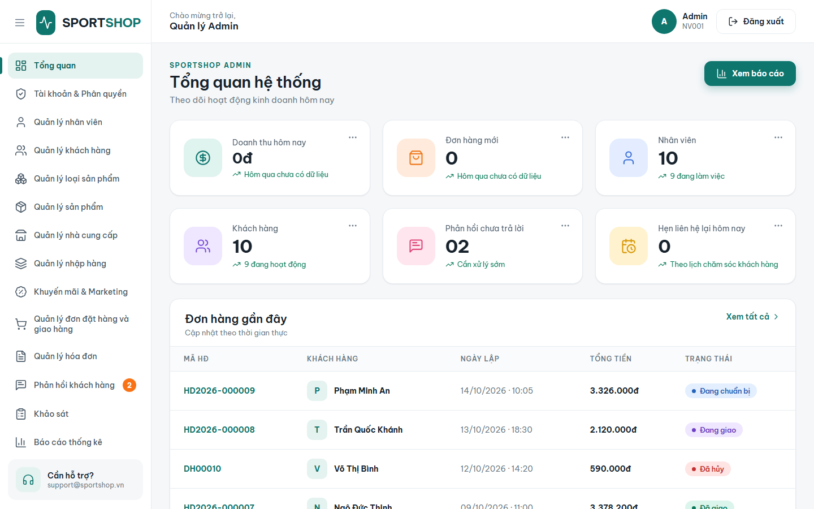</a> |
| **Quản lý sản phẩm (`/Products`)** | Chế độ xem Lưới & Danh sách, bảng thêm/sửa biến thể tự động, lọc danh mục. | <a href="docs/screenshots/admin_products.png">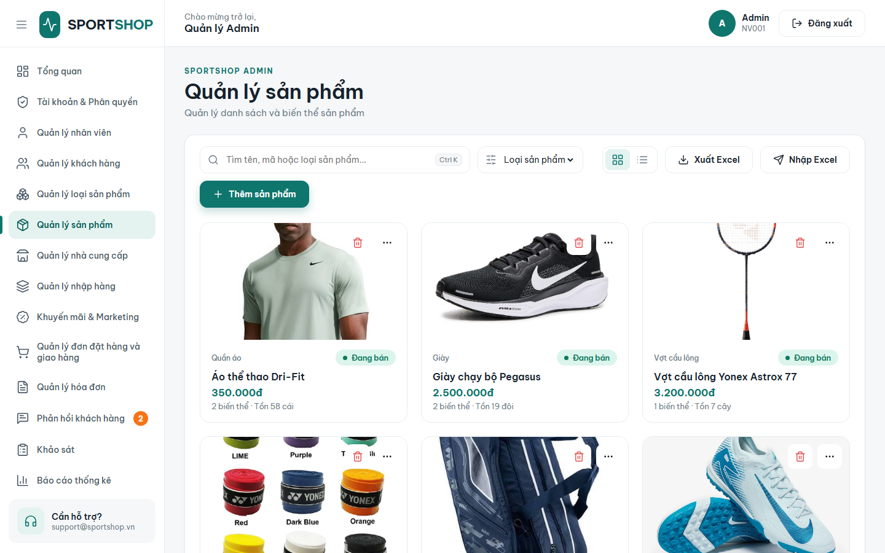</a> |
| **Nhập & Xuất Excel sản phẩm** | Nút **Xuất Excel** và **Nhập Excel** hàng loạt biến thể (size, màu, giá, tồn) bằng ClosedXML. | <a href="docs/screenshots/admin_excel_product.png">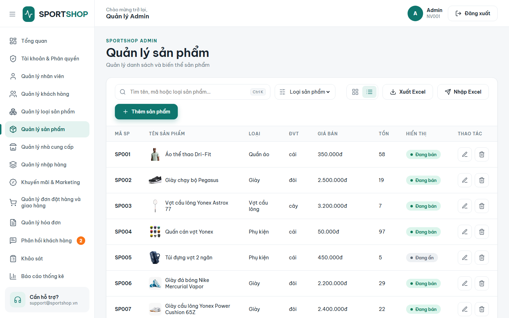</a> |
| **Bộ tìm kiếm trực quan (Query Builder)** | Bộ lọc nâng cao: `Cột - Toán tử (=, >, chứa...) - Giá trị` nối bằng logic `VÀ / HOẶC`. | <a href="docs/screenshots/admin_search_builder.png">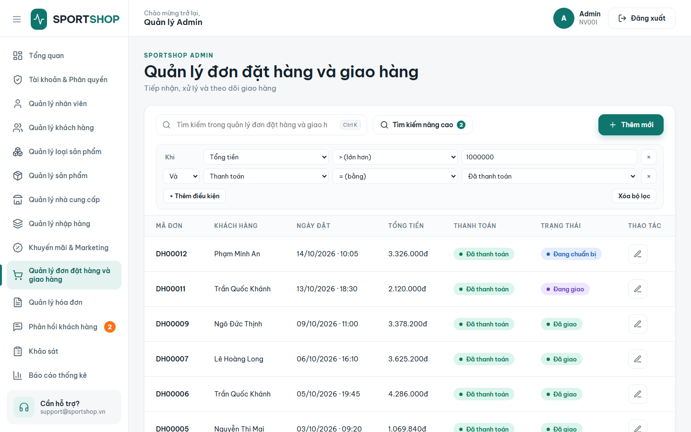</a> |
| **Quản lý đơn hàng & Bán tại quầy** | Duyệt đơn online, lập đơn bán hàng tại quầy (trừ tồn kho tức thì), xem nhanh ở panel phải. | <a href="docs/screenshots/admin_orders.png">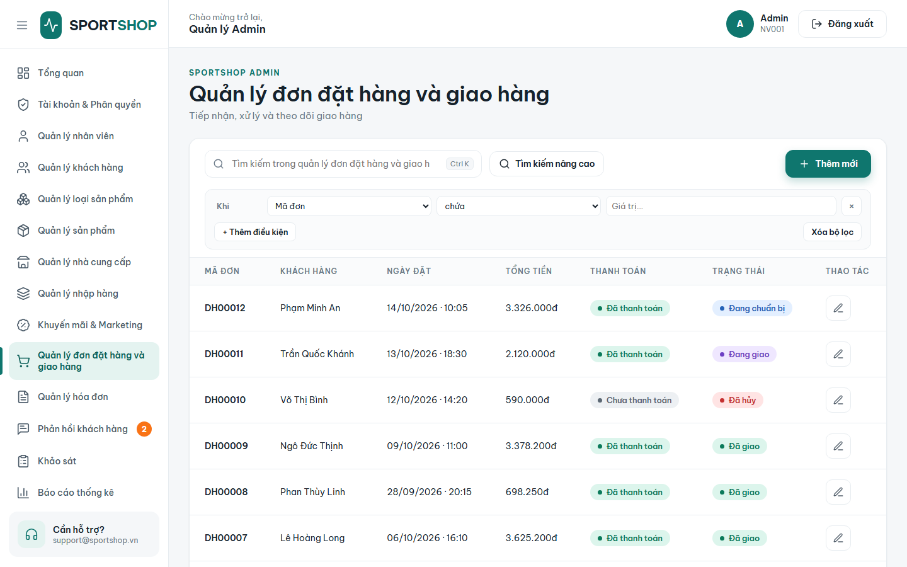</a> |
| **Hóa đơn bán hàng** | Danh sách hóa đơn tài chính tự động sinh khi đơn giao thành công, hỗ trợ in hóa đơn. | <a href="docs/screenshots/admin_invoices.png">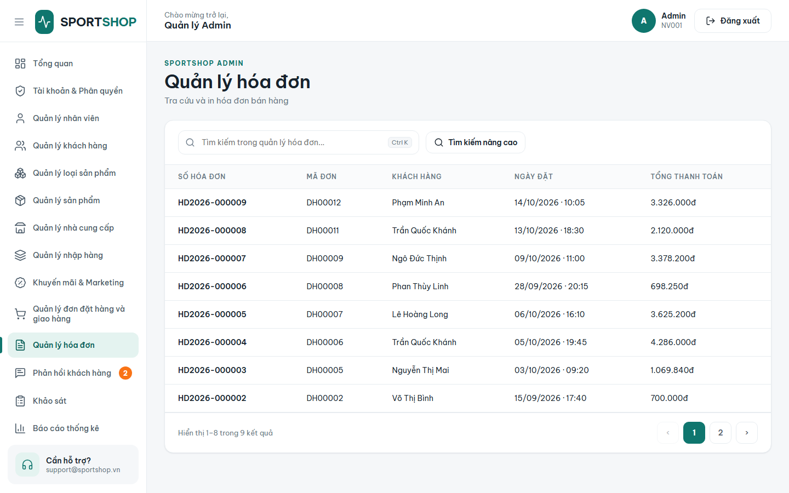</a> |
| **Nhập hàng nhà cung cấp (`/Imports`)** | Lập phiếu nhập kho, tự động cập nhật giá vốn và cộng dồn số lượng tồn kho biến thể. | <a href="docs/screenshots/admin_imports.png">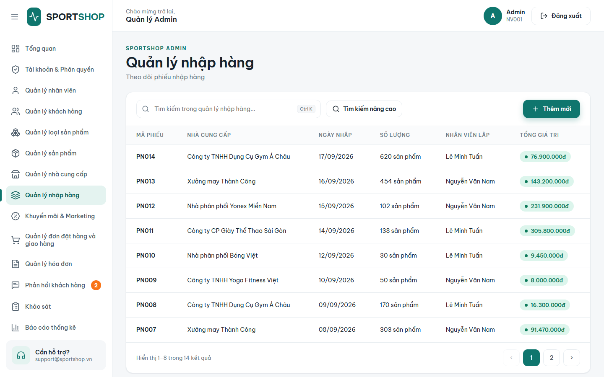</a> |
| **Quản lý khách hàng CRM (`/Customers`)** | Hồ sơ khách hàng, phân hạng Bạc/Vàng/VIP, ghi chú chăm sóc và hẹn ngày liên hệ lại. | <a href="docs/screenshots/admin_customers.png">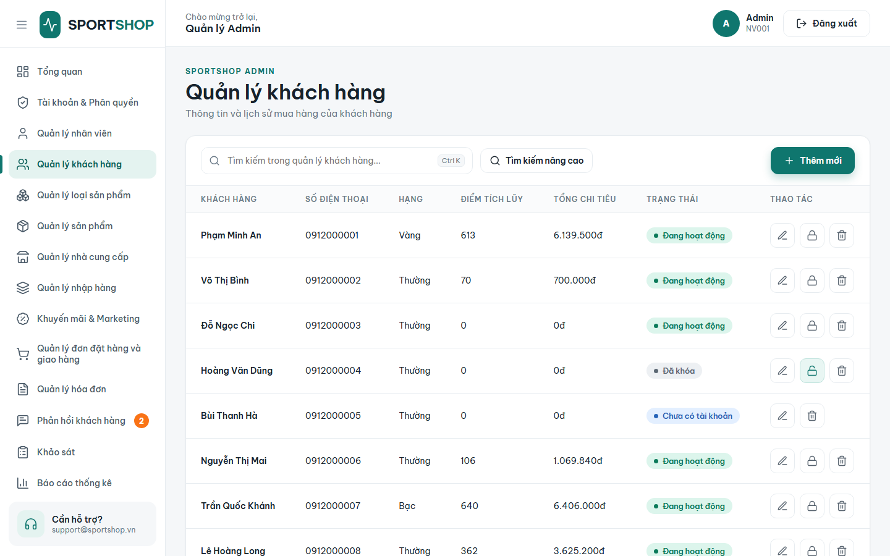</a> |
| **Phân nhóm khách hàng** | Tạo nhóm khách hàng tự động theo độ tuổi, giới tính, sở thích thể thao hoặc mức chi tiêu. | <a href="docs/screenshots/admin_groups.png">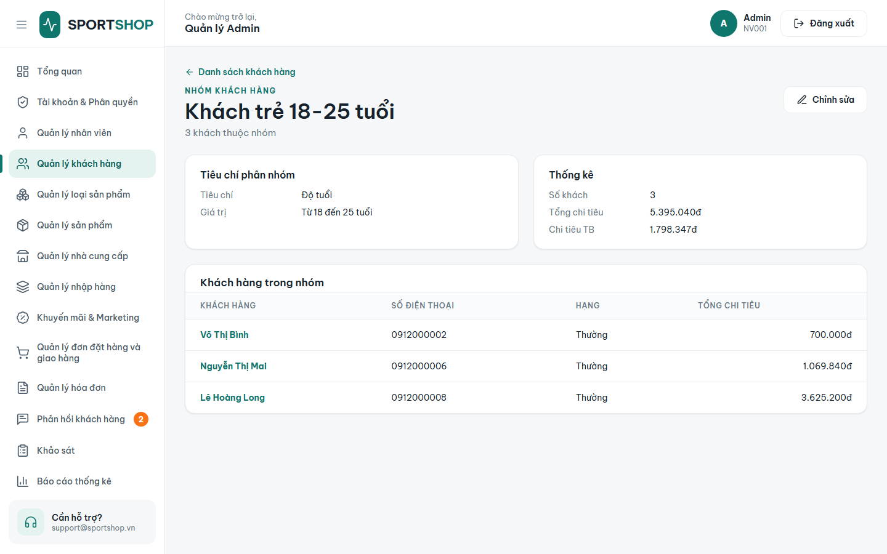</a> |
| **Khuyến mãi & Voucher (`/Promotions`)** | Thiết lập chương trình giảm giá, mã voucher giới hạn số lần dùng theo hạng thành viên. | <a href="docs/screenshots/admin_promotions.png">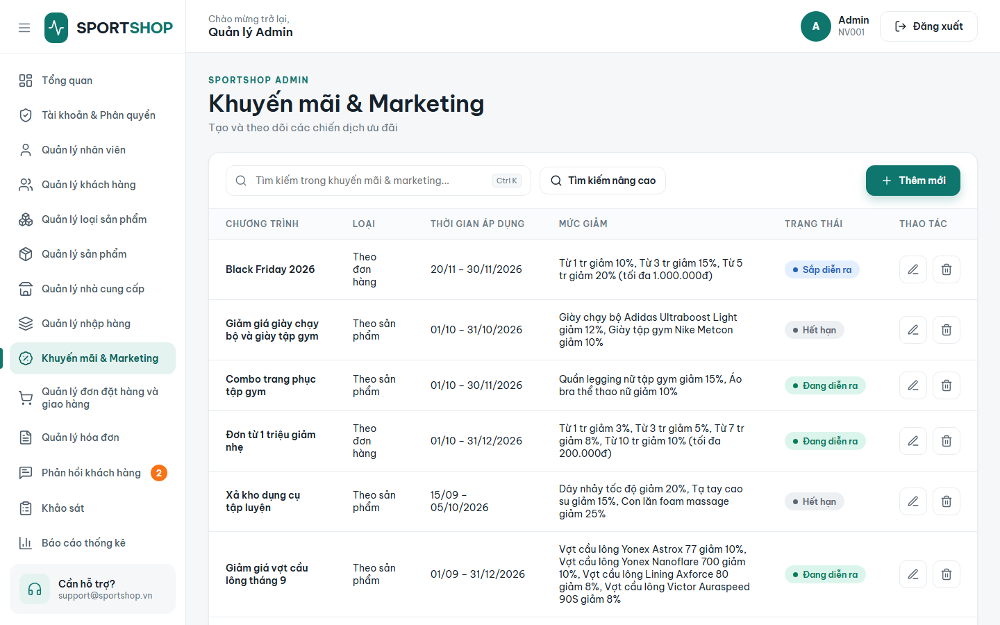</a> |
| **Hộp thư phản hồi (`/Feedback`)** | Tiếp nhận đánh giá của khách (in đậm thư chưa đọc), viết câu trả lời gửi lại khách. | <a href="docs/screenshots/admin_feedback.png">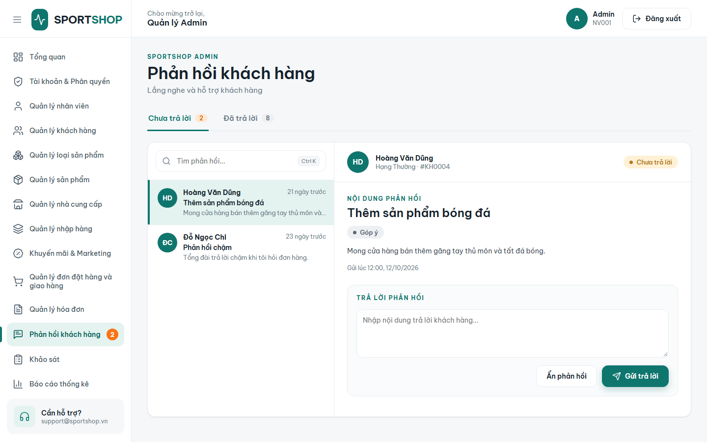</a> |
| **Khảo sát khách hàng** | Soạn thảo câu hỏi khảo sát, chỉ định nhóm khách tham gia và xem biểu đồ kết quả. | <a href="docs/screenshots/admin_surveys.png">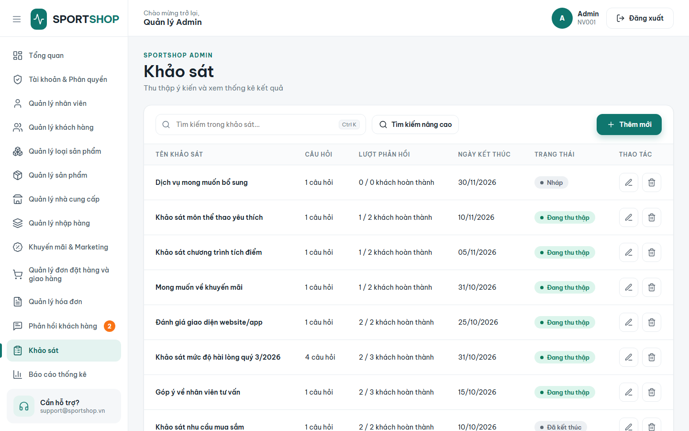</a> |
| **Báo cáo kinh doanh (`/Reports`)** | Lọc theo khoảng ngày: doanh thu, chi phí, lợi nhuận gộp, top sản phẩm bán chạy. | <a href="docs/screenshots/admin_reports.png">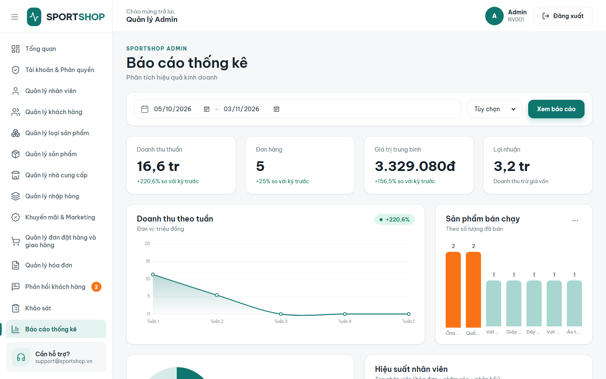</a> |
| **Thống kê doanh thu chuyên sâu (`/Stats`)** | Phân tích doanh thu đa chiều (ngày, tháng, nhân viên, khách, sản phẩm), **Xuất Excel đa sheet**. | <a href="docs/screenshots/admin_stats.png">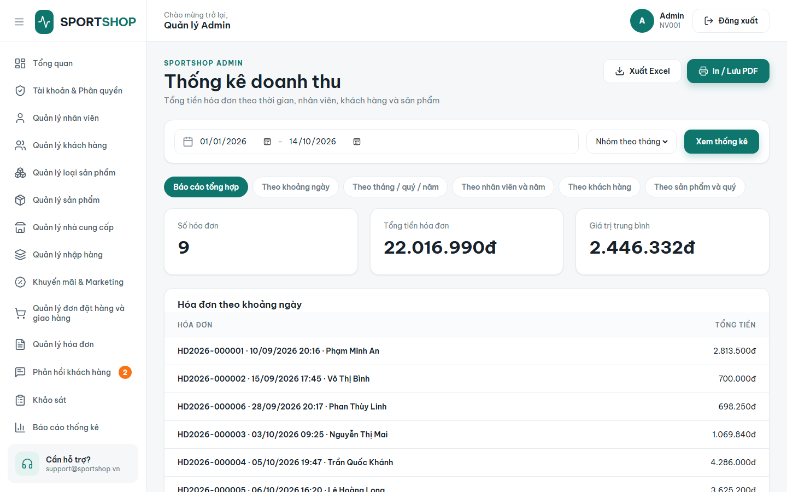</a> |
| **Quản lý nhân viên & Phân quyền** | Danh sách nhân viên, tài khoản hệ thống. Chặn nhân viên thường truy cập trang này. | <a href="docs/screenshots/admin_employees.png">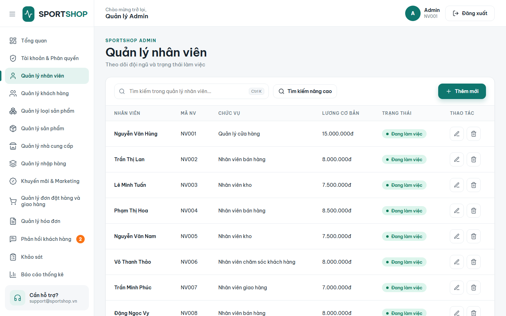</a> |

---

## 🎯 Quy tắc nghiệp vụ cốt lõi

### 1. Quy tắc áp dụng Voucher
- **Mã khách mới** (`WELCOME5`, `NEWBIE15`...): Tên chương trình chứa từ khóa *"bạn mới"*, *"khách mới"*, *"người mới"*. Chỉ dùng duy nhất **1 lần cho đơn hàng đầu tiên**.
- **Mã theo hạng thành viên**:
  - Hạng Bạc (`BAC8`, `BAC15`): Dùng tối đa **2 lần / khách**.
  - Hạng Vàng (`VANG5`, `VANG10`): Dùng tối đa **3 lần / khách**.
  - Mốc xét hạng: Chi tiêu ≥ **2 triệu** ➔ Bạc; ≥ **5 triệu** ➔ Vàng; ≥ **10 triệu** ➔ VIP.
- **Hoàn trả voucher:** Khách hoặc nhân viên hủy đơn thì lượt dùng voucher tự động được trả lại.

### 2. Luồng trạng thái đơn hàng
- Chu trình chuẩn: `Chờ xác nhận` ➔ `Đang chuẩn bị hàng` ➔ `Đang giao hàng` ➔ `Đã giao`.
- Chỉ chuyển sang `Đã giao` hoặc `Đã hủy` (ở bước muộn) khi đơn đã ở trạng thái thanh toán hợp lệ.
- Khi chuyển `Đã giao`: Hệ thống tự động tạo hóa đơn, cộng dồn doanh số, thăng hạng thành viên và tích điểm (10.000₫ = 1 điểm).
- Hủy đơn: Bắt buộc điền lý do hủy, hoàn lại số lượng tồn kho biến thể vào CSDL.

### 3. Đa phiên đăng nhập độc lập (Virtual Tab Session)
- Ứng dụng tích hợp `TabCookieMiddleware` và `tab-session.js`. Mỗi tab trình duyệt lưu 1 mã session 32 hex trong `sessionStorage`.
- Cho phép mở nhiều tab để đăng nhập **nhiều tài khoản khác nhau** (ví dụ: tab 1 là Admin, tab 2 là Nhân viên, tab 3 là Khách hàng) trên cùng 1 trình duyệt mà **hoàn toàn không bị đè phiên của nhau**.

---

## 🏗️ Tổ chức mã nguồn & Kiến trúc

- **Luồng dữ liệu tinh gọn:** `Controller ➔ Service/Model ➔ MySQL Dapper` (không lạm dụng Repository pattern cồng kềnh, phân tách rõ luồng đọc `ShopData`/`ShopStore` và luồng ghi `ShopCommands`).
- **Form tự động (`CrudDefs.cs`):** Định nghĩa cấu trúc trường trong C#, JavaScript tự render form ở panel bên phải, tiết kiệm thời gian tạo View HTML thủ công.
- **Xóa mềm (Soft Delete):** Mọi bảng dữ liệu quan trọng đều có cột `da_xoa`, dữ liệu lịch sử đơn hàng và phiếu nhập luôn được bảo toàn tuyệt đối.
- **Chế độ Offline:** Web khách hàng tích hợp `DbStatus` và `StoreData.cs` mẫu, nếu chưa kết nối CSDL web vẫn render giao diện mẫu mà không bị crash hay báo lỗi 500.

---

## ❓ Xử lý lỗi thường gặp

1. **Lỗi `Lỗi kết nối CSDL`:** Kiểm tra dịch vụ MySQL đang chạy trong `services.msc`, kiểm tra đúng cổng (3306) và mật khẩu trong `appsettings.json`.
2. **Lỗi `Table doesn't exist`:** Chạy file `Backend/Database/sports_shop.sql` và cả 3 file trong thư mục `Backend/Database/Migrations/`.
3. **Lỗi file `.dll` / `.exe` bị khóa khi build:** Do tiến trình web cũ đang chạy ngầm. Mở PowerShell gõ: `Stop-Process -Name dotnet -Force` rồi build lại.
4. **Bị chặn không vào được trang Quản trị:** Kiểm tra xem tài khoản đăng nhập có được liên kết với hồ sơ trong bảng `NHAN_VIEN` chưa.
